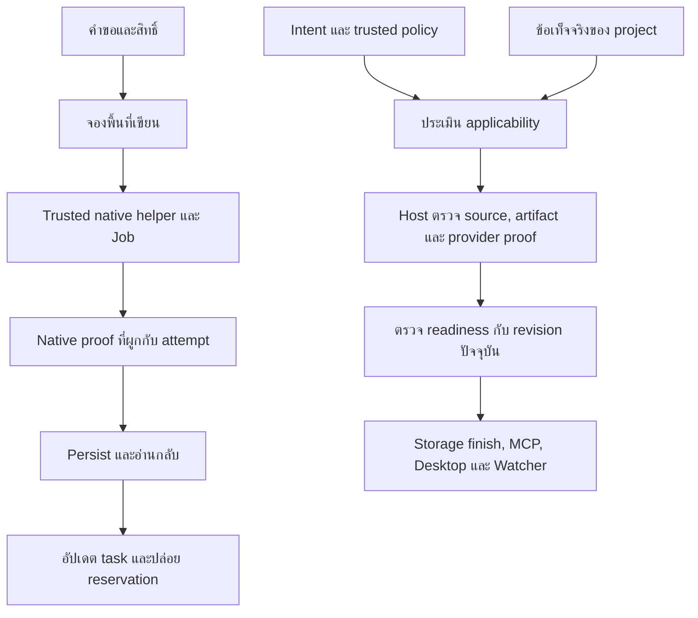

# แผนแก้ Issues #213 และ #214 เพื่อเตรียม lnwjud v5.9.0

> แผนและหลักฐานด้านล่างเก็บตามวันที่เดิม สถานะล่าสุดของ Issue #213–#217 และ #219 รวมทั้งข้อจำกัด updater และ macOS อยู่ใน [ทะเบียนรับมอบ](2026-10-20-v5.9.0-issues-213-217-acceptance.md) ยังไม่ถือว่างานทั้งหมดเสร็จหรือมีสิทธิ์ปล่อย release

อัปเดตสถานะเมื่อ 2026-10-20 ตามเวลาไทย. งาน 5.9.0 อยู่ใน working tree บน `dev`. ผล full release verification วันที่ 2026-10-19 ในตารางด้านล่างเป็นหลักฐานของรอบก่อน ไม่ครอบคลุมการย้าย Windows native service และแพตช์ล่าสุด. ยังต้องตรวจรับงานเหล่านั้นก่อนเผยแพร่.
เป้าหมายคือให้งาน Windows ทำงานภายใต้ Restricted Execution Policy และให้ Engineering Gates ตรวจรับตามประเภทงานกับหลักฐานจริง.
ขอบเขตรวมเส้นทางร่วมของ process launch, receipt, Writer Admission, gate applicability, persistence, recovery และการแสดงสถานะ.
อ้างอิง [Issue #213](https://github.com/engasnm111/lnwjud/issues/213) และ [Issue #214](https://github.com/engasnm111/lnwjud/issues/214).
source version คือ 5.9.0; เวอร์ชันที่เผยแพร่ล่าสุดยังเป็น 5.8.7. ยังไม่มีการ commit, push, เปิด PR, tag หรือเผยแพร่ release.
การตรวจ source และ package integrity ไม่ยืนยันผลการติดตั้ง, hosted CI, macOS/Linux acceptance หรือ public release; หลักฐานแต่ละชั้นอยู่ในตารางสถานะด้านล่าง.
PR-590 เป็นรหัสในแผน ยังไม่มี GitHub PR หมายเลขนี้. งาน implementation รวมใน PR จาก dev ไป main เมื่อได้รับอนุญาตให้เปิด PR.
หลังเผยแพร่มี PR เอกสารตาม release process แยกจาก tag และ artifact ที่เผยแพร่แล้ว.
แก้ครบในแผนนี้หมายถึงปิดทุกกรณีใน inventory และ acceptance matrix ของสองกลุ่มนี้ ไม่ใช่อ้างว่าไม่มีบั๊กอื่นใน repository.

## How to read this

One box is one unit of work. Every box names the evidence that checks it. Check a box only when its evidence exists.
Execution follows `playbooks/autopilot-stack.md`, with repository rules in `AGENTS.md` taking precedence.
Tests alone are not sufficient verification. A PR is verified only when its unit, live, and perf boxes are all checked.
Checkbox ที่ว่างเป็นงานในอนาคต ไม่ใช่ผลตรวจที่ผ่านแล้ว. ภาคผนวกแยกข้อค้นพบจาก source, ข้อเสนอ และสิ่งที่ยังไม่พิสูจน์.

## สถานะ implementation และการตรวจรับ

รอบกู้คืน Desktop วันที่ 2026-10-20 พบว่า IPC contract และ main ส่ง gate applicability `unresolved` ได้ แต่ preload ปฏิเสธค่านี้ ทำให้ Dashboard เปิดไม่ได้เมื่อมี Goal ดังกล่าว. แก้ตัวตรวจให้รับสถานะตาม contract โดยรักษา gate status และ reason เดิม. Regression ก่อนแก้ล้มเฉพาะ `unresolved`; หลังแก้ชุด Dashboard/Tool Catalog ผ่าน 19/19. ทดสอบตัวติดตั้งเดิมกับ profile แยกที่คัดลอก Goal พร้อม checkpoint/capsule history แล้วเกิด `Invalid IPC response`; executable ที่สร้างใหม่เปิด Dashboard และรักษา unresolved gates ได้. หลักฐานอยู่ใน `.audit/v5.9.0-dashboard-ipc-*.log` และภาพ `.audit/v5.9.0-dashboard-ipc-fixed.png`.

การ rebuild ยังพบจุดค้างของ ProcessManager ที่อ้าง cancel/receipt path ซึ่งถอดไปแล้ว. ย้ายไปใช้ `nativeLaunch.cancel()` และตรวจ native proof ผ่านช่องทางเดิม. Focused process tests ผ่าน 19 เคสและข้าม 2 เคส; mock เหล่านี้ไม่แทนการตรวจ native service จริง. รอบนี้ใช้เครื่องมือในเครื่องตามคำสั่งผู้ใช้ ไม่อาศัยปลั๊กอิน lnwjud ในการแก้หรือสร้างแพ็กเกจ. การติดตั้งทับและตรวจ connector/runtime จริงยังเป็นขั้นรับงานถัดไป.

สร้าง Setup และ Portable ชุดกู้คืน 5.9.0 สำเร็จวันที่ 2026-10-20. Canonical package command และตัวตรวจ SHA/provenance จบด้วย exit 0. Packaged startup smoke เปิดหน้า AppShell สำเร็จโดย `bootError=0`; unresolved gates ทั้งสองยังมีสถานะ stale. รอบนี้ยังไม่ติดตั้งทับข้อมูลจริงและยังไม่เผยแพร่ public release.

| ชั้น | สถานะ | หลักฐานหรือสิ่งที่ยังขาด |
| --- | --- | --- |
| Source และ regression | implementation และ regression checks ผ่าน local verification บน `dev` | native containment, durable writer admission, import publication และ Engineering applicability/readiness มี regression tests ใน package ที่เกี่ยวข้อง; full release verification จบด้วย exit 0 |
| Version และเอกสาร | source เป็น 5.9.0; published version คง 5.8.7 | canonical `set-version`, What's New ไทย/อังกฤษ, README, FULL_README และ RELEASE_NOTES ปรับแล้ว; release-gate tests ผ่านหลังแก้ README |
| Local verification | ผ่าน | `scripts/verify-release.ps1 -SkipWindowsPackaging` จบด้วย exit 0. ผ่าน `test:version` (5 passed), lint, typecheck, `test:release` (รวม Desktop 853/853, MCP 1,484 passed/3 skipped, capabilities 442 passed/4 skipped, CLI 33/33, storage 121/121, application 363/363), acceptance 39/39, integration 3/3, E2E 18/18, build, tool catalog (`298` total/`286` default/`298` Codex), packaging 88/88, release gate 34/34 และ `git diff --check` |
| `@lnwjud-pc` session ปัจจุบัน | connector พร้อมใช้งานกับ workspace `lnwjud`; read-only preparation ผ่าน | `mcp_health` เป็น ready; workspace root และ source `package.json` เป็น `E:\lnwjud` / 5.9.0. `engineering_prepare_task` สำหรับ local readiness โหลด project profile ได้ (confidence strong), เปิด Engineering Harness และจัด delivery เป็น local; `diff` กับ `docs_impact` ยัง pending จนกว่าจะมี task/Goal จริงและการส่งหลักฐาน. Inventory ที่ connector คืนยังไม่มี `engineering_build_artifact`, `engineering_complete_build`, `engineering_upload_worker` และ `recover_blocked_goal`; จึงยังทดสอบเครื่องมือเหล่านี้ผ่าน connector session นี้ไม่ได้ |
| Installed/fresh runtime | ติดตั้งและเปิดแอป 5.9.0 บน Windows แล้ว; fresh-session connector acceptance ยังไม่ยืนยัน | ผู้ใช้ยืนยันว่าติดตั้งแล้ว. Host อ่าน `ProductVersion=5.9.0.0` จาก `C:\Program Files\lnwjud\lnwjud.exe` และพบโปรเซสแอปที่กำลังทำงานจาก path เดียวกัน. ยังไม่มี fresh-session inventory/readback; ไม่อ้างว่า connector gate ผ่าน |
| Native/package/hosted acceptance | Windows package และ installed startup ผ่าน; hosted acceptance ยังรอ | สร้าง `lnwjud-Setup-5.9.0.exe` และ `lnwjud-Portable-5.9.0.exe`; `verify-release-evidence.mjs` ผ่าน, SHA-256 ตรงกับ `SHA256SUMS.txt` และ `PROVENANCE.json`; ทั้งคู่เป็น `NotSigned` ตาม local build policy. ต้องรอ exact-SHA hosted CI และ macOS/Linux hosted run |
| Release | รอ exact-head review และ hosted acceptance | ยังไม่มี tag, GitHub Release หรือ post-release documentation sync. เดิน release process `dev -> main` ผ่าน branch protection และตรวจ exact-SHA hosted jobs ก่อนเผยแพร่ |

`@lnwjud-pc` ที่รายงานข้างต้นคือ connector ตามชื่อที่ผู้ใช้ยืนยัน. การเชื่อมต่อพร้อมและการอ่าน workspace ใน session นี้เป็นหลักฐาน live-session เท่านั้น ไม่ใช้แทน installed-version หรือ fresh-session acceptance.

คำสั่งผู้ใช้และ `AGENTS.md` มาก่อน playbook. ทำ implementation บน `dev`; ไม่ใช้ branch ย่อย, worktree แยก หรือเปิด schedule อัตโนมัติ.
คำขอแรกกำหนดเป้าหมายเป็น release 5.9.0 และผู้ใช้สั่งทำต่อจนเสร็จ จึงเริ่ม implementation, version sync และ release preparation ได้. ในการคุยล่าสุดผู้ใช้ถามว่าจะสร้าง Windows installer ให้ลองก่อนหรือไม่; ขั้นที่กำลังรออยู่จึงเป็นผลติดตั้งของผู้ใช้ก่อน public release ไม่ใช่การขออนุญาตทำ implementation เพิ่ม.
หลังรับผลติดตั้งแล้ว ให้เดิน release process `dev -> main` ผ่าน branch protection และ exact-SHA hosted checks; อย่าสร้าง tag หรือ public artifact ก่อน gates เหล่านี้ผ่าน.

ใช้หลัก Sequence Work into Verifiable Units แบ่งงานเป็น P0 ถึง P8 และตรวจรับก่อนขั้นถัดไป.
ใช้หลัก Prove It Works แยก source tests, Windows native tests, packaged acceptance และ hosted release evidence.
ใช้หลัก Encode Lessons in Structure วาง regression ที่สัญญาข้อมูลและจุดตัดสินสถานะ เพื่อป้องกันการแก้เฉพาะข้อความ error.

## Program checklist

รายการนี้เก็บ gate และหลักฐานที่ละเอียดจากแผนเดิม. กล่องที่ยังว่างหมายถึงหลักฐานของ acceptance lane นั้นยังไม่ถูกยืนยันตามเกณฑ์ของมัน; อ่านร่วมกับตารางสถานะล่าสุดด้านบน และอย่าตีความว่า source implementation ยังไม่เกิดขึ้น.
Repository standing orders ใน `AGENTS.md` กำหนด branch, release, scheduler และ package acceptance.

### Arm the program

- [x] ผู้ใช้สั่งทำต่อจนเสร็จเพื่อเป้าหมาย release 5.9.0; ขอบเขต implementation คือ Issues #213/#214 และกรณีที่เกี่ยวข้อง. การคุยล่าสุดกำหนดให้ผู้ใช้ลอง local Windows installer ก่อน public release.
- [ ] ตรวจ HEAD, working tree และ ownership อีกครั้ง. เริ่มงานบน `dev` โดยไม่ทับงานคนอื่น. เก็บ SHA เริ่มต้น.
- [ ] อ่าน `AGENTS.md`, `docs/development/RELEASE_PROCESS.md` และ installed plugin ที่เกี่ยวข้อง. ใช้กฎ repository แทน topology และ scheduler ของ playbook.
- [ ] บันทึกว่า hourly continuation ยังไม่ได้รับอนุญาต. ไม่สร้าง schedule จนกว่าผู้ใช้อนุญาตแยก และต้องใช้ workspace scheduled-continuation skill.
- [ ] ถ้าใช้ durable Goal ที่ได้รับอนุญาต ให้ checkpoint ทุก milestone พร้อม `resumeContext`, blockers และ `trackedTasks` ก่อนส่ง status message.
- [ ] เมื่อผู้ใช้สั่งหยุด ให้หยุดการเขียนและเก็บสถานะที่ต่อได้. งานวางแผนรอบนี้ไม่สร้าง durable Goal ใหม่.

### Spawn owners

- [ ] ให้ผู้รับผิดชอบหลักเป็นผู้เขียนร่วมเพียงคนเดียวใน `dev`. ผู้ช่วยตรวจ source/หลักฐานต้องไม่เขียนทับไฟล์ร่วม.
- [ ] ทำ P0 แล้ว P1, P2, P3 ตามลำดับ. P4/P5 ใช้ contracts จาก P0. P6 รอ runtime และ engineering contracts คงที่.
- [ ] เริ่ม P7 เมื่อ functional regression ผ่านแล้ว. เริ่ม P8 ตามสิทธิ์ release ที่ผู้ใช้ให้จริง.
- [ ] ทุก scope ที่เพิ่มต้องมี caller หรือ invariant เชื่อมกับสอง issue. ปิด inventory แต่ไม่ขยายเป็นการ rewrite capability ทั้งระบบ.
- [ ] ใช้ผู้ตรวจอิสระเรื่อง native lifecycle, trust และ applicability ก่อน merge. ผลสำรวจในแผนนี้ไม่ใช่ review implementation.

### PR mechanics, for every PR

- [ ] ใช้ `dev -> main` เท่านั้น. ไม่สร้าง feature branch หรือ worktree สำหรับแยกงาน.
- [ ] แยก commits ตามหน่วยที่ตรวจสอบได้ และแยก functional change จาก version sync. ตรวจ diff ก่อน push.
- [ ] รัน lint, typecheck และ required checks. ผูกผลกับ commit SHA จริง.
- [ ] ก่อนเปลี่ยนเวอร์ชันใช้ `corepack pnpm@10.15.0 run set-version 5.9.0` แล้วรัน `corepack pnpm@10.15.0 test:version` ทันที.
- [ ] ก่อน push version-changing commit รัน release verification ตาม `AGENTS.md` และ `git diff --check`. คง current published version จน release สาธารณะผ่านการยืนยัน.
- [ ] เมื่อเปิด PR ที่ได้รับอนุญาต ให้แนบ PR กับ chat. ไม่โพสต์ comments หรือส่งข้อความให้ผู้รายงานโดยอัตโนมัติ.

### Verdict and merge, for every PR

- [ ] เก็บ exact head/base SHA และ reviewer verdict. ประเมินผลเดิมใหม่เมื่อ patch เปลี่ยน.
- [ ] ระบุ exact GitHub Actions run ID ก่อนติดตาม. ใช้ watcher เดิมถ้ามี หรือ `gh run watch <RUN_ID> -i 20 --exit-status` เพียงหนึ่ง authoritative watcher ต่อ run.
- [ ] ยืนยัน watcher terminal และ workflow conclusion. เมื่อ fail อ่าน log ของ run นั้นก่อนซ่อม ไม่ blind rerun หรือเพิ่ม timeout แทน root-cause fix.
- [ ] ปิด correctness/security/compatibility findings ก่อน merge. Mock ไม่ทดแทน native หรือ packaged acceptance.
- [ ] หลัง merge ตรวจ CI ของ main merge SHA ใหม่. ห้าม tag SHA ที่ required target-native jobs ยังไม่ผ่าน.

### Boot recipe, for every live lane

- [ ] ใช้ disposable test workspace/profile แยกข้อมูลจริง. ใช้ checkout หรือ artifact ที่ยืนยัน SHA แล้ว โดยไม่สร้าง worktree ใหม่.
- [ ] ใช้ Windows 10/11 x64 VM ที่ effective policy เป็น Restricted. อ่าน `Get-ExecutionPolicy` และ `Get-ExecutionPolicy -List` ก่อนและหลัง.
- [ ] ตรวจว่า app/child ไม่รับ `PSExecutionPolicyPreference=Bypass` จาก test runner. แยก build environment จาก acceptance environment.
- [ ] รัน Desktop HTTP MCP และ packaged STDIO ผ่าน client fixture ที่มี owner identity ชัดเจน. อ่าน task, Goal และ receipt กลับผ่าน API ร่วมกับหลักฐาน native.
- [ ] ใช้ `corepack pnpm@10.15.0 --filter @lnwjud/desktop exec playwright test --config playwright.config.ts` สำหรับ Desktop และกำหนด `LNWJUD_PACKAGED_EXECUTABLE` ตาม CI ของ OS.
- [ ] ใช้ test Worker หรือ deployment readback ที่ได้รับอนุญาตสำหรับ Cloudflare. ไม่ deploy โปรเจกต์ลูกค้าจากแผนนี้. แยก sanitized fixtures จาก live provider acceptance.
- [ ] เก็บ log, receipt, manifest และภาพใน `.audit/v5.9.0/<sha>/lane-<n>/`. ภาพใช้ตรวจ UI; JSON/native proof ใช้ตัดสิน lifecycle.
- [ ] รายงาน OS/build, architecture, application version, SHA, artifact digest, route, scenario และผลอ่านกลับ. ไม่เก็บ credentials หรือ secret-bearing commands.

## แก้ process lifecycle และ Engineering Gates แล้วเตรียม v5.9.0 (PR-590)

**Depends on.** คำสั่งเริ่ม implementation. P0 เป็นฐานทุกขั้น. P7 รอ P1 ถึง P6. P8 รอ local acceptance และสิทธิ์ release.

**Files.**

- [ ] เพิ่ม `native/windows-containment-helper/` สำหรับ source, project, protocol และ native tests. เป็น path ที่เสนอ ยังไม่มีใน baseline.
- [ ] แก้ `packages/process/src/windows-contained-launch.ts`, `windows-contained-process.ts`, `process-manager.ts`, `process-types.ts` และ tests. ย้าย native C# ออกจาก runtime string เมื่อทุก caller migrate แล้ว.
- [ ] แก้ `packages/capabilities/src/durable-shell-task-store.ts`, `durable-shell-task-index.ts`, `shared-managed-writer-admission.ts`, `shell-backend.ts` และ lifecycle tests.
- [ ] แก้ `packages/capabilities/src/repository-import-runtime.ts`, `repository-import-worker-source.ts`, `repository-import-scripts.ts` และ `windows-repository-import-anchor.ts` ตาม P3. ลบ runtime assets ที่ไม่มี caller แล้ว.
- [ ] ตรวจ `packages/application/src/process-service.ts`, `writer-admission.ts`, `git-service.ts`, `codex-service.ts` และ `packages/codex/src/codex-adapter.ts`. แก้เฉพาะเส้นทางที่ต้องร่วม admission/lifetime contract.
- [ ] แก้ host wiring ใน `apps/desktop/src/main/desktop-services.ts` และ `apps/cli/src/runtime/stdio-mcp-runtime.ts` เพื่อส่ง trusted helper dependency.
- [ ] เพิ่ม helper build/integrity generation และเชื่อม `scripts/package-windows.ps1`, `apps/desktop/package.json`, `apps/desktop/electron-builder.yml` กับ CI/package tests.
- [ ] แก้ `apps/desktop/scripts/capture-packaged-runtime-evidence.mjs`, `write-release-evidence.mjs`, `verify-release-evidence.mjs` และ required runtime inventory.
- [ ] แก้ `packages/domain/src/engineering.ts`, `packages/shared/src/engineering-policy.ts` และ tests เพื่อเพิ่ม typed applicability/evidence contracts.
- [ ] แก้ assessment, policy, workflow และ preparation ใน `packages/application/src/engineering/`. เพิ่ม bounded capability assessment กับ pure applicability evaluator.
- [ ] แก้ `packages/application/src/goal-continuation-service.ts`, `packages/storage/src/goal-repository.ts` และ integration tests. เพิ่ม migration เฉพาะเมื่อ persistence ต้องเปลี่ยน.
- [ ] แก้ `packages/mcp-server/src/engineering-evidence-verifier.ts`, `tools/schemas.ts`, `tools/engineering-tools.ts`, `tools/goal-tools.ts` และ contracts.
- [ ] แก้ `apps/desktop/src/main/watcher-projection.ts`, status composition, IPC และ UI ที่แสดงเหตุผล. ไม่แก้ repository `lnwjud-watcher` โดยอัตโนมัติ.
- [ ] อัปเดต README, FULL_README, RELEASE_NOTES, `docs/USAGE_TH.md`, Windows packaging และ release guidance. เพิ่ม contract/migration doc ปัจจุบันโดยรักษาเอกสารประวัติศาสตร์.
- [ ] เพิ่ม What's New exact version ใน `apps/desktop/src/renderer/features/release-notes/release-notes.ts` และคำแปลใน `apps/desktop/src/renderer/i18n/messages.ts`.

**Build.**

### P0 ยืนยันขอบเขตและเขียน regression ที่แยกสาเหตุได้

- [ ] ยืนยัน runtime ของผู้รายงานและจำแนก `blocked` ว่าเป็น terminal status หรือ active Goal ที่มี blockers. ใช้ข้อมูลที่ได้รับอนุญาตและปกปิดข้อมูลลูกค้าใน public fixtures.
- [ ] ทำ inventory ของ launch, receipt parsers, terminalization, admission release, index cleanup และ recovery. ทุกแถวมี caller, OS, writer scope และหลักฐานที่อนุญาตให้ release.
- [ ] ทำ inventory ของ gate creation, N/A, evidence verifier, parser, reconciliation, finish และ status projections.
- [ ] เขียน failing regression ของ Restricted launch, receipt binding/readback, late receipt, platform round-trip และ Worker applicability. ตรวจ failure ว่าจับ defect ที่ตั้งใจจริง.
- [ ] ระบุ trust model ว่า Job Object คุม lifetime และ admission คุม writers ผ่าน lnwjud. ทั้งสองอย่างไม่ใช่ sandbox ป้องกันทุก process ใต้ Windows user เดียวกัน.
- [ ] ปิดข้อเลือก protocol, helper distribution และ applicability authority ด้วย design review. ข้อที่ยังไม่พิสูจน์ต้องมี acceptance ก่อน release.

### P1 สร้าง native helper และ receipt contract เดียว

- [ ] ใช้ first-party .NET executable ที่ build ผ่าน pipeline ทางการ ตาม precedent secret migrator. ให้เป็น self-contained Windows x64 ไม่ต้องติดตั้ง SDK หรือ PowerShell 7 บนเครื่องผู้ใช้.
- [ ] เลือก target framework ให้ตรง Windows support policy. ไม่คัดลอก minimum Windows build จาก helper อื่นจนเพิ่มข้อกำหนดโดยไม่ตั้งใจ.
- [ ] แยก launcher protocol, Job lifecycle และ bounded import-control operations เป็นโมดูลภายใน. ไม่เพิ่ม generic interpreter หรือ elevation.
- [ ] ให้ request มี protocol version, task/reservation ID, request digest, attempt/generation, owner/workspace binding, executable, argv, cwd และ timeout. ส่งผ่านช่องควบคุม ไม่ต่อเป็น shell string.
- [ ] สร้าง Job แบบ kill-on-job-close และ target แบบ suspended. ผูก Job ก่อน resume พร้อมตรวจทุก native result.
- [ ] ใช้ `PROC_THREAD_ATTRIBUTE_JOB_LIST` บน Windows ที่รองรับเพื่อปิด crash window ระหว่าง create กับ assignment. ตรวจ membership ก่อน resume. Job creation/assignment failure ต้อง fail closed.
- [ ] จำกัด inherited handles ด้วย explicit list. target ต้องไม่รับ Job owner handle, control channel หรือ receipt writer.
- [ ] ให้ host แยก helper spawned จาก target safely started. แจ้ง running เมื่อมี bound start acknowledgement ที่พิสูจน์ assign/resume แล้ว.
- [ ] รอ native zero-active-process evidence หลัง completion/timeout/cancel. เก็บ target exit code แยก helper exit code และ termination reason.
- [ ] ผูก terminal receipt กับ task/reservation/request/attempt/owner/workspace/helper identity/protocol และ outcome. PID/timestamp อย่างเดียวไม่ใช่ identity.
- [ ] กำหนด issuer authority ที่ตรวจหลัง restart ได้. ใช้ private authenticated control transport และ durable attestation ที่ host ตรวจผู้สร้างได้. Binding/hash ของ JSON อย่างเดียวไม่ถือเป็น authority.
- [ ] ใน P0 เลือกและ review กลไก durable attestation เช่น keyed authentication ที่ใช้ host-managed key ตาม profile. ไม่ส่ง key ผ่าน argv/env/log/request file หรือ handles ที่ target inherit. ระบุ key rotation/loss และ Desktop/STDIO verifier compatibility ก่อนลงมือ P1.
- [ ] Persist แบบ atomic พร้อม flush และอ่านกลับเพื่อตรวจ schema/identity/digest. Reject reparse redirection, stale/partial/oversized receipt และ unsupported schema.
- [ ] แยก target stdout/stderr จาก receipt control channel. target output สร้าง verified proof เองไม่ได้.
- [ ] แยก `launch_not_started`, `running`, `terminal_verified` และ `termination_unknown`. Prelaunch rejection ต้องมี host proof ว่า attempt ยังไม่เริ่ม.
- [ ] เก็บ verified cessation of writes แยกจาก operation outcome. การพิสูจน์ว่าไม่มี writer เหลืออาจอนุญาต release admission แต่ห้ามแปลง command outcome ที่ไม่รู้เป็น success.
- [ ] หลังเริ่ม attempt แล้ว receipt ที่หาย/เสีย/ไม่ตรง/พิสูจน์ไม่ได้ต้อง UNKNOWN. ห้าม replay operation เพื่อสร้าง receipt ใหม่.

### P2 ผูกทุกจุดปล่อย Writer Admission กับหลักฐานเดียวกัน

- [ ] ให้ ProcessManager และ durable store ใช้ helper/validator เดียว รวม generated worker, reconciliation และ index reclamation.
- [ ] รักษาลำดับ permission/scope, reserve, persist identity, verify helper, launch, native proof, terminal persist/readback แล้วจึง release.
- [ ] Release ต้องผูก owner/attempt และ await ผลได้. Retry persist/reconcile/release ต้องไม่ execute command ซ้ำ.
- [ ] แก้ late valid receipt ให้เปลี่ยน `termination_unverified` สู่ proven terminal พร้อม waiter/callback/state ที่สอดคล้องกันและเกิดครั้งเดียว.
- [ ] ให้ index cleanup, snapshot/list, timeout, cancel และ restart recovery ใช้ terminal authority เดียว. `task.json` ที่ระบุ completed เองไม่พอ.
- [ ] ถ้า persistence/readback ไม่ผ่านให้คง reservation/quarantine พร้อมเหตุผล. ไม่ปลดด้วย TTL, Exit Code 0 หรือ missing PID.
- [ ] ทดสอบสอง runtime instances ใช้ admission directory ร่วมกัน รวม Desktop/STDIO และ owner/workspace/attempt ต่างกัน.
- [ ] กำหนด migration ของ v1 receipt. เก็บประวัติได้แต่ไม่เติม binding ย้อนหลัง. Unresolved legacy attempt ต้องไม่ replay หรือปลดจาก v1 เพียงอย่างเดียว.
- [ ] รักษา task caps, output limits, quoting, environment, hidden windows และ timeout. ตรวจ pending cancellation ก่อน resume.
- [ ] รักษา durable caller-disconnect semantics. การหลุดของ MCP client ไม่เท่ากับการสั่ง cancel งาน durable.

### P3 ปิดปัญหาคล้ายกันใน first-party control paths

- [ ] ย้าย import stage ACL, stage identity, publish และ verify-published จาก generated PowerShell ไป bounded native operations. Baseline ยังใช้ `-File`/`Add-Type`/Bypass ในกลุ่มนี้.
- [ ] รักษา create-only DACL-at-create, NTFS handle identity, same-volume, ancestor pinning, reparse rejection และ no-replace publication. ไม่ลดเป็น path-only copy/rename.
- [ ] ผูก prepared/published receipt กับ request/source. เมื่อ publish อาจเกิดแล้วแต่ proof ไม่ครบให้ unresolved และอ่าน native identity โดยไม่ clone/publish ซ้ำ.
- [ ] Persist replacement แบบ atomic และทดสอบ crash ก่อน publish, หลัง publish และก่อน terminal readback.
- [ ] ตรวจ foreground shell, Codex และ non-Windows Git ตาม inventory. หากเป็น admitted workspace writer ให้ถือ reservation จนหลักฐานยืนยัน descendants สิ้นสุด.
- [ ] ถ้าเส้นทางตั้งใจอยู่นอก admission ให้ระบุขอบเขตและเหตุผลที่ตรวจแล้ว. ห้ามนับว่า covered เพราะเรียก ProcessManager อย่างเดียว.
- [ ] ตรวจ POSIX ordinary completion, process groups, cancellation และ recovery ด้วย invariant เดียวกัน แต่ใช้กลไก native ของ macOS/Linux.
- [ ] แยก PS `-Command` identity probes จาก `-File` bootstrap. ไม่เหมารวมทุก PowerShell capability ว่ามี defect เดียวกัน.
- [ ] ทุก inventory row ต้องเป็น fixed, unaffected-with-evidence หรือ unsupported-with-reason. แถวในขอบเขตที่ยังไม่ตัดสินเป็น release blocker.
- [ ] Script ที่ผู้ใช้ร้องขอยังอยู่ใต้นโยบายเครื่อง. Helper ไม่ใช่ช่องข้าม Restricted สำหรับ user scripts.

### P4 แยก capability facts, delivery policy และ applicability

- [ ] เพิ่ม typed delivery profile แยก requested task, observed capability, required proof และ requirement authority.
- [ ] เก็บ facts แบบ bounded read-only. แยก present/absent/unreadable/unsupported/unknown ของ Git, remotes, CI, artifact, deployment และ platforms.
- [ ] ไม่ execute repository-provided commands ตอน assessment. ไม่บันทึก credential-bearing remote URL หรือ provider secrets.
- [ ] รองรับ trusted user policy สำหรับ workflow ที่ตั้งใจไม่มี hosted CI. Repository declarations ให้ข้อมูลและเพิ่มความเข้มได้ แต่ลด trusted requirement เองไม่ได้.
- [ ] Host คำนวณ applicability เป็น required/optional/not_applicable/unresolved พร้อม reason code, authority, policy/capability digest และ intent revision. Client ส่ง stamp นี้เองไม่ได้.
- [ ] เก็บ gate verification status แยก applicability. N/A ต้องมีเหตุผลและหลักฐาน ไม่แปลงเป็น passed.
- [ ] ใช้ provider-neutral delivery/evidence contracts สำหรับ serverless/web/desktop/local/library/container. ไม่ hardcode Cloudflare เพื่อข้ามทุก gate.
- [ ] คง `exact_sha_ci` เมื่อ policy บังคับ. ไม่มี remote/login, provider ล่ม หรืออ่าน config ไม่ได้ ไม่ใช่สิทธิ์ยกเว้น.
- [ ] เมื่อ hosted CI ไม่เกี่ยวข้องตาม trusted policy ให้ CI N/A พร้อม required local validation/source identity ตาม risk. ไม่บังคับผู้ใช้สร้าง remote.
- [ ] ให้ `package` ตรวจ artifact ที่ส่งมอบตามงาน. Worker ใช้ bundle/version, static web ใช้ output manifest, container ใช้ digest และ desktop ใช้ installer/provenance.
- [ ] Local work ที่ไม่ส่ง artifact ใช้ N/A ได้เมื่อ applicability พิสูจน์แล้ว. Deploy ยังต้องพิสูจน์ payload แม้ไม่มี installer.
- [ ] ซ่อม `requiredPlatforms` ให้ validate/persist/readback ครบ. ตรวจ platform set ตาม contract ไม่ใช่ชื่อ job เฉพาะ lnwjud.
- [ ] รักษา regression ข้อความปฏิเสธ/อ้างอดีต/planning-only ทั้งไทยและอังกฤษ. การพูดถึง release ไม่ใช่ release authorization.
- [ ] Harness คง default Off. Off ไม่เพิ่ม scans/ceremony และไม่ลบ obligations ใน Goal เดิม.

### P5 ตรวจหลักฐานตาม contract และกู้คืน Goal เดิม

- [ ] แยก provider parser จาก policy evaluator. คง GitHub/lnwjud adapter และเพิ่ม bounded structured-observation seam ที่ host verify.
- [ ] เพิ่ม Cloudflare version/deployment readback adapter. ตรวจ account, Worker, environment, version/deployment IDs, traffic และ source/artifact binding.
- [ ] ขอบเขต adapter ที่ส่งใน 5.9.0 คือ GitHub CI เดิม, Cloudflare Worker version/deployment readback และ local source/artifact verification. Provider-neutral seam ใช้ host-observed contract fixtures; CI provider อื่นที่ยังไม่มี adapter ต้องแสดง unsupported/unresolved ไม่สัญญา live integration ที่ยังไม่ทำ.
- [ ] ไม่ใช้ version ID ตัวเดียวพิสูจน์ commit. เชื่อม source snapshot, build manifest/digest และ version ที่ provider ยืนยัน.
- [ ] แยก uploaded version จาก deployed version. Full rollout ต้อง 100%; canary ใช้ traffic target ที่ผู้ใช้อนุมัติ.
- [ ] Worker version ไม่พิสูจน์ D1/KV/R2 หรือ external-resource migration. คง gates ของผลกระทบนั้นแยก.
- [ ] Custom Release Manager ใช้ bounded receipt/schema กับ host-observed/readback proof. ข้อความ success หรือ client-authored JSON ไม่ใช่ trusted proof.
- [ ] Git projects ต้อง bind exact deployed source รวม dirty/untracked inputs ที่เข้า build. ไม่ใช้ clean tracked HEAD แทน payload ทั้งหมด.
- [ ] No-Git ใช้ explicit snapshot/content-manifest digest ภายใต้ trusted policy. Missing SHA ไม่ใช่ wildcard สำหรับ Git requirement.
- [ ] ตรวจ artifact digest/manifest ตามชนิด ไม่ใช้ extension, nonempty size และ mtime แทน source binding.
- [ ] ตรวจ workspace/source/intent/contract/provider/time/terminal result. Reject stale, wrong-target, running, failed และ proof ที่นำไปใช้ข้าม source/target/attempt/contract โดยไม่มีสิทธิ์. รับ proof เดิมซ้ำใน binding เดิมอย่าง idempotent และ preserve เมื่อ substantive contract ยังตรง.
- [ ] รวม reconciliation เป็น application service เดียวสำหรับ engineering_start_task และ resume/run_goal ที่เกี่ยวข้อง. Preserve proof เฉพาะ substantive contract ที่ยังตรง.
- [ ] รองรับ schema v1 และ migration แบบ versioned. เก็บ decision/evidence changes ใน checkpoint history ไม่ rewrite ประวัติว่าเคยผ่าน.
- [ ] Active Goal ที่มี blockers ใช้ current lease/revision reassess แล้ว finish ตามปกติเมื่อครบ.
- [ ] Terminal `status=blocked` ใช้ explicit audited recovery transition ที่ตรวจ owner authority, expected revision, reason, policy และ liveness ก่อนกลับ active.
- [ ] Recovery ไม่เปิด completed/cancelled/superseded Goal หรือ schedules เอง. หลักฐานไม่ครบยัง blocked. ไม่สร้าง Goal ใหม่เพื่อหลบเกณฑ์.
- [ ] หลัง recovery acquire lease ใหม่และผ่าน completion validation ปกติ. ไม่ direct SQL หรือรับ authoritative metadata จาก client.

### P6 ให้ MCP, Desktop และ Watcher แสดงตรงกัน

- [ ] สร้าง pure completion-readiness evaluator จาก trusted domain state. Storage ตรวจซ้ำใน transaction; MCP/Desktop/Watcher ใช้ผลประเมินเดียวกัน.
- [ ] รวม required gates, unresolved applicability, stale proof, blocking findings, criteria, blockers และ blocking tasks.
- [ ] คง source/provider verification ที่ต้อง I/O ใน application/runtime layer. UI ไม่เป็น evidence authority.
- [ ] แสดง applicability reason, requirement authority, missing proof และ supported recovery action. ไม่แนะนำปิด security checks.
- [ ] ส่ง typed/redacted rejection codes แทน generic invalid input เมื่อระบุสาเหตุได้.
- [ ] อัปเดต direct checkpoint_goal และ alias checkpoint_goal_engineering พร้อม schemas. Compatibility ต้องไม่ข้าม ownership/evidence.
- [ ] ทดสอบ HTTP MCP, packaged STDIO และ fresh `@lnwjud-pc` session. แยก inventory/schema/direct-call/get_goal readback จาก installed-version proof.
- [ ] ตรวจ Watcher API backward compatibility. ถ้าต้องแก้ client นอก repo ให้ระบุเป็นงานแยกที่ต้องอนุมัติ.

### P7 เตรียมเอกสาร เวอร์ชัน และ artifact

- [ ] เพิ่ม helper build ใน local package/CI paths. Dev ที่ไม่มี helper ต้อง fail closed พร้อมคำแนะนำ build ที่ถูกต้อง.
- [ ] Resolve helper ด้วย absolute canonical path จาก trusted resources. ตรวจ architecture/protocol/version/integrity ก่อน launch.
- [ ] ผูก binary/manifest กับ trusted packaged integrity root และ release SHA/provenance. Exe กับ sidecar hash ที่แก้คู่กันได้ไม่พอเป็น provenance.
- [ ] ปิด PATH shadowing, current-directory lookup, reparse replacement และ untrusted environment override.
- [ ] รวม helper/manifest ใน packaged-runtime evidence, PROVENANCE, SHA256SUMS, artifact-only verifier, Setup, Portable และ updater. Hash bytes หลัง signing.
- [ ] ตรวจ clean machine ไม่มี checkout/SDK และ upgrade จาก 5.8.7 โดยไม่ลบ history หรือ replay งาน.
- [ ] บันทึก Authenticode ตามจริง. NotSigned ที่ไม่มี configured certificate ไม่เป็น failure เพียงลำพัง. Configured signing gate ต้องคงเดิม.
- [ ] เขียน migration/recovery guide สำหรับ unresolved tasks, blocked Goals, helper repair และ delivery policy. ไม่แนะนำลบ locks/receipts.
- [ ] เมื่อ functional tests/reviews ผ่าน ค่อยใช้ canonical set-version/test:version และตรวจ drift. เติม script หาก current-version reference ยังไม่ครอบคลุม.
- [ ] เพิ่ม What's New 5.9.0 ไทย/อังกฤษ, README highlights และ release history. Current published คงเวอร์ชันที่เผยแพร่จริง.
- [ ] รัน full local release gate ก่อน push และเก็บ evidence ผูก SHA.

### P8 เผยแพร่เมื่อได้รับอนุญาตและหลักฐานครบ

- [ ] ส่ง dev -> main PR พร้อม acceptance matrix/limitations. ไม่อ้างว่าแก้บนเครื่องลูกค้าแล้วจาก fixtures.
- [ ] ตรวจ exact PR-head CI/review ก่อน merge. ถ้ายังไม่มีสิทธิ์ merge/publish ให้ส่งมอบพร้อม review แล้วหยุดที่ขอบเขตนั้น.
- [ ] หลัง merge ตรวจ main SHA และ CI artifact ของ Windows x64, macOS arm64/x64, Linux arm64/x64 รวม macOS 26 compatibility บน artifact เดิม.
- [ ] ใช้ exact-run watcher และ terminal conclusions ก่อน tag v5.9.0. หาก merge automation ไม่สร้าง push run ให้ workflow_dispatch ตาม release process.
- [ ] Release workflow ต้องใช้ artifact จาก exact main CI และตรวจ manifest/provenance ไม่ rebuild ชุดใหม่.
- [ ] ยืนยัน public Release, asset inventory/hashes/provenance/update feeds และ helper ใน output จริง.
- [ ] หลัง publication ผ่าน ค่อยใช้ `node scripts/sync-published-docs.mjs v5.9.0 --apply` บน dev แล้วตรวจแบบไม่มี `--apply`.
- [ ] ส่ง docs follow-up PR จาก dev ไป main และ sync dev. ไม่ rewrite immutable tag หรือ historical evidence.
- [ ] ถ้ามี authorized Goal ให้ checkpoint/finish/get_goal ยืนยัน terminal. Cleanup authorized schedule ตาม workspace skill ก่อนกล่าวว่าจบ.

**You see.**

- [ ] Managed commands ทำงานบน Restricted โดย policy ไม่เปลี่ยนและไม่มี containment PowerShell bootstrap.
- [ ] Timeout/cancel/crash ไม่ทำให้ descendants ที่ยังอาจเขียนถูกนับว่าหยุดแล้ว. Admission ปลดเมื่อ proof ครบ.
- [ ] Late valid receipt กู้ state/readback/admission ได้โดยไม่เพิ่ม execution ของ request เดิม.
- [ ] Worker local/no-hosted-CI ปิด Goal ได้เมื่อ trusted policy กับ required source/test/artifact/deployment/security proof ครบ.
- [ ] Desktop release ที่ต้องมี CI/package ยัง blocked เมื่อหลักฐานขาด. lnwjud release gates ไม่อ่อนลง.
- [ ] Platform subset คงอยู่หลัง restart และ MCP/Desktop/Watcher แสดง blocker ตรงกัน.
- [ ] ผู้ใช้ 5.8.7 เห็น recovery action ตามหลักฐานที่มี. งานที่พิสูจน์ได้กู้คืนโดยไม่ replay; legacy unknown ที่ไม่มี authority ยังคง quarantine พร้อมข้อจำกัดตาม Appendix C.

**Verify, unit.** Tests alone are not sufficient verification. A PR is verified only when its unit, live, and perf boxes are all checked.

- [ ] Native helper/process tests ตรวจ argv/stdio/fail-before-resume/identity/readback faults ตาม Appendix E.
- [ ] Durable/admission/import tests ตรวจ side-effect count กับ reservation owner ในสอง runtime instances.
- [ ] Engineering workflow/policy/assessment/evidence tests ตรวจ positive/negative cases ใน Appendix F.
- [ ] SQLite round-trip ตรวจ requiredPlatforms และทุก field ใหม่ รวม v1/future schema/invalid enums/failed migration.
- [ ] Recovery tests ตรวจ preserve valid proof, stale changed contract, retry idempotency และ wrong lease/owner/CAS rejection.
- [ ] MCP/alias/IPC/Watcher/UI tests ตรวจ blocking findings และ completion parity.
- [ ] Packaging tests ตรวจ missing/tampered helper รวมเปลี่ยน exe+sidecar พร้อมกัน และ artifact-only required runtime.
- [ ] Existing permission, Active Project, Full Bypass และ rolling goal-lease tests ต้องไม่ regress.
- [ ] ใช้ Appendix G และเพิ่ม targeted regression ใน test homes ที่ระบุ. บันทึก exit status/test names/SHA. ยังไม่ได้รัน application tests ในรอบวางแผน.

**Verify, live.** Tests alone are not sufficient verification. A PR is verified only when its unit, live, and perf boxes are all checked. Ten lanes on the configured `swarm workers` model at the PR head.

สิบ lane เป็นชุดสถานการณ์ตรวจรับ. ใช้ profile/VM แยกกันหรือรันตามลำดับ ไม่แย่ง workspace เดียวกัน.
เก็บ log/receipt ร่วมกับภาพ. ไม่ใช้ screenshot แทน native proof.

- [ ] Lane 1. Regression lane against trunk. เปรียบเทียบ 5.8.7/candidate บน Windows 10/11 Restricted ด้วย side effect ที่นับครั้งได้. Save `lane-1/restricted.png`. Pass when candidate รันครั้งเดียว, native zero-active/readback ครบ และ policy ไม่เปลี่ยน พร้อมบันทึกผล baseline ตามจริง.
- [ ] Lane 2. Denied approval/scope/command/stale lease และ helper missing/tampered/wrong arch. Save `lane-2/denied.png`. Pass when ไม่มี target side effect, fallback หรือสิทธิ์เพิ่ม.
- [ ] Lane 3. Timeout/cancel กับ child/grandchild และ root ที่ออกก่อน descendants. Save `lane-3/descendants.png`. Pass when Job ยืนยัน zero active ก่อน readback/release.
- [ ] Lane 4. Helper/host crash, receipt absent/corrupt/stale/wrong task และ storage fault. Save `lane-4/recovery.png`. Pass when UNKNOWN คง admission และ late proof recovery ไม่ replay.
- [ ] Lane 5. Desktop/STDIO concurrent writers, duplicate request และ import publication interruption ภายใต้ Restricted. Save `lane-5/concurrency.png`. Pass when execution/publication count ถูกต้องและ NTFS/no-replace/admission invariants คงอยู่.
- [ ] Lane 6. Setup/Portable clean machine และ upgrade 5.8.7 พร้อม legacy tasks. Save `lane-6/packaged.png`. Pass when helper มาจาก trusted package, digest ตรง และ history/recovery ไม่เสีย.
- [ ] Lane 7. Test Worker local Git/no remote/no CI ที่ policy อนุญาต. Save `lane-7/serverless.png`. Pass when host ยืนยัน source/artifact/version/deployment/traffic และ finish_goal completed โดยไม่มี fake installer. Custom manager ใช้ host-observed contract fixture แยกจาก live Worker proof.
- [ ] Lane 8. Desktop GitHub CI, static web/container/no-Git artifact fixtures และ CI provider ที่ยังไม่รองรับ. Save `lane-8/applicability.png`. Pass when proof ตรงประเภทงาน; provider-neutral fixture ผ่าน contract และ unsupported/unknown/failed/wrong-source ไม่ถูกนับเป็น live success.
- [ ] Lane 9. Existing Goal, platform subset, stale contract, review findings และ terminal blocked recovery. Save `lane-9/readiness.png`. Pass when persistence/MCP/Desktop/Watcher ตรงกันและ wrong-owner/CAS recovery reject.
- [ ] Lane 10. macOS/Linux lifecycle/admission และ fresh @lnwjud-pc inventory/schema/direct-call/readback. Save `lane-10/cross-platform.png`. Pass when existing OS guarantees คงอยู่และ installed runtime/session ใหม่ใช้ contract ที่แก้จริง.

**Verify, perf.** Tests alone are not sufficient verification. A PR is verified only when its unit, live, and perf boxes are all checked.

- [ ] Metric. วัด launch-to-start, launch-to-verified-release, cancel-to-zero-active, cold/warm helper cost, assessment/readiness latency และ idle CPU/handles. แยก provider network latency.
- [ ] Probe. ใช้ workload เดียวกันสลับ baseline/candidate 30 คู่ หลัง warm-up 5 ครั้ง. เก็บ median/p95 และ lifecycle 500 รอบหลัง warm-up พร้อม Harness-Off no-op 100 รอบ.
- [ ] Baseline. วัด trunk ก่อนใน environment ที่ baseline รันได้จริง. Restricted baseline ที่ fail ไม่ใช่ latency 0 หรือ speedup ratio. Candidate Restricted ใช้ absolute budget แยก.
- [ ] Rule. Proposed budget ให้ p95 overhead เพิ่มไม่เกิน 20% หรือ 100 ms แล้วแต่ค่าใดมากกว่า, cancel-to-verified ไม่เกิน 10 s, warm no-op receipt ไม่เกิน 2 s และ cold readiness ไม่เกิน 5 s บน reference VM. Handles หลัง 500 รอบต้องกลับใน baseline-noise range และไม่มี linear growth. Harness Off เพิ่ม assessment/network calls เป็น 0. ตัวเลขเป็นเกณฑ์เสนอ ยังไม่ใช่ผลวัด; เปลี่ยนต้องมี baseline rationale ก่อนตัดสิน candidate.

**Review gate.** ผู้ใช้ตรวจ interaction และผู้ตรวจอิสระตรวจ lifecycle/evidence contracts ก่อน merge.

- [ ] เก็บ screenshot ของ denied/unknown/recovered และ required/N/A/unresolved จาก lanes 2, 4, 7, 9.
- [ ] เก็บ video ของ reassessment จน completed และอีกกรณีที่หลักฐานไม่ครบแล้วยัง blocked.
- [ ] ส่งผลให้ operator พร้อม trust boundary/remaining gaps. ความเงียบไม่ใช่ approval.
- [ ] รับ independent verdict เรื่อง helper/receipt trust, atomic admission, policy downgrade resistance และ migration. ปิด findings ก่อนพร้อม merge.

**Merge.**

- [ ] ยืนยัน exact-head verdict, required PR CI และ acceptance ที่เกี่ยวข้อง.
- [ ] ตรวจสิทธิ์ merge/publication ณ เวลานั้นแล้ว merge dev -> main ผ่าน branch protection.
- [ ] ทำ P8 บน exact main SHA กับ artifacts ที่ CI สร้าง. ตรวจ publication ก่อนเปลี่ยน published references.
- [ ] ตรวจ docs follow-up PR และ dev sync ตาม canonical process.

## Close the program

- [ ] ปิดทุก mandatory row ใน Appendix E/F และ inventory ด้วย evidence หรือ disposition ที่ผู้ใช้ยอมรับ. ไม่เปลี่ยน failure เป็น N/A เพื่อ release.
- [ ] ยืนยัน v5.9.0/public assets/installed helper/migration/fresh-session acceptance ตามสิทธิ์ที่ได้รับ.
- [ ] เก็บ exact SHA/run/artifact links และ known limitations โดยไม่เผยข้อมูลลูกค้าหรือ credentials.
- [ ] Finish/cleanup authorized Goal เมื่อเสร็จจริง. ส่งรายงานแยก verified, blocked และ unrun.
- [ ] สำหรับรอบวางแผนนี้ ส่ง Markdown กับผลตรวจรูปแบบแล้วหยุดก่อน implementation.

## Appendix A Prototype evidence และสถานะที่ตรวจจริง

ไม่มี executable prototype ในรอบนี้ เพราะผู้ใช้สั่งให้ทำแผนก่อน. ตารางนี้เป็นหลักฐานจาก issue, Git และ source ไม่ใช่ผลผ่าน native/package acceptance.

| สิ่งที่ตรวจ | ผล ณ วันที่วางแผน | ขอบเขตของหลักฐาน |
| --- | --- | --- |
| Repository | `E:\lnwjud` บน `main` ที่ `d7da7d3dc8e0bd9b44010b2a1eb7ddaa43d2c741` หลัง merge PR #212 | อ่านอย่างเดียว ไม่สลับ branch |
| Development branch | `dev` และ `origin/dev` ที่ `fd3407207e0e2c584812e8f38e062b9c4a93c037` | เนื้อหาตรงกับ main แม้ SHA ต่างกัน. ต้องอ่าน baseline ใหม่ก่อน implementation |
| Working tree | พบงานเดิมที่ยังไม่ track ใน `.agents/skills/ppt-master/` | ไม่แก้ ย้าย หรือลบงานเดิม |
| Version ใน source | root, Desktop และ process package เป็น `5.8.7` | ยังไม่ได้ใช้ `set-version` |
| Public release | GitHub latest เป็น `v5.8.7` เผยแพร่ `2026-10-16T21:03:32Z` ไม่ใช่ draft/prerelease | ตรวจ release metadata ไม่ได้ติดตั้ง package ใหม่ในรอบนี้ |
| Release tag | `v5.8.7` ชี้ commit `1a0453ed0ef1de4cdf9ce1ba9edee8da0de8426b` | ต่างจาก HEAD ที่สำรวจ จึงต้องเก็บ test/package SHA ให้ชัด |
| Issue #213 | ผู้รายงานพบ Restricted policy ปฏิเสธ generated `containment.ps1` แล้วไม่มี terminal receipt | อาการจากรายงานและเส้นทางใน source ยังไม่ reproduce บน VM รอบนี้ |
| Issue #214 | ผู้รายงานระบุ Worker deploy/smoke/traffic สำเร็จ แต่ติด `exact_sha_ci` กับ `package` | ไม่ได้ยืนยัน Cloudflare account หรือ deployment จริงของผู้รายงาน |
| สิ่งที่ไม่ทำ | ไม่มี app tests, builds, native probes, version bump, commit/push, PR, release หรือ schedule | ทุก acceptance checkbox ยังว่างตามจริง |

แหล่ง baseline คือ [Issue #213](https://github.com/engasnm111/lnwjud/issues/213), [Issue #214](https://github.com/engasnm111/lnwjud/issues/214), [HEAD ที่สำรวจ](https://github.com/engasnm111/lnwjud/tree/d7da7d3dc8e0bd9b44010b2a1eb7ddaa43d2c741) และ [release v5.8.7](https://github.com/engasnm111/lnwjud/releases/tag/v5.8.7).

## Appendix B ข้อค้นพบที่กำหนดขอบเขตงาน

เลขบรรทัดอ้างถึง HEAD ใน Appendix A. ข้อความว่าเสี่ยงหรืออาจเป็นข้ออนุมานที่ต้องมี regression/native proof ก่อนสรุปเป็น defect ที่ยืนยันแล้ว.

| ID | หลักฐานจาก source | ผลต่อแผน |
| --- | --- | --- |
| N1 | [windows-contained-launch.ts](../../packages/process/src/windows-contained-launch.ts) บรรทัด 19-45 สร้าง C#/PS1 แล้วเรียก PowerShell ด้วย `-File` | ย้าย bootstrap ไป first-party executable โดยไม่เปลี่ยน policy ของเครื่อง |
| N2 | [windows-contained-process.ts](../../packages/process/src/windows-contained-process.ts) บรรทัด 33-65 สร้าง suspended process แล้ว assign Job และ resume | รักษา invariant เดิมและปิด orphan window ระหว่าง create/assign ด้วย creation-time Job assignment ที่ตรวจบน Windows จริง |
| N3 | [windows-contained-launch.ts](../../packages/process/src/windows-contained-launch.ts) บรรทัด 48-56 กับ [durable-shell-task-store.ts](../../packages/capabilities/src/durable-shell-task-store.ts) บรรทัด 1242-1248 ตรวจ receipt shape แต่ไม่มี task/request/attempt binding | ใช้ receipt contract เดียวพร้อม binding และแยก target output ออกจาก proof |
| N4 | [durable-shell-task-index.ts](../../packages/capabilities/src/durable-shell-task-index.ts) บรรทัด 106-111 reclaim จาก receipt; [durable-shell-task-store.ts](../../packages/capabilities/src/durable-shell-task-store.ts) บรรทัด 542-591 มีเส้นทาง release จาก metadata | ทุก releaser ต้องใช้หลักฐานเดียวกัน ไม่ให้ parser หรือ marker cleanup เป็นทางลัด |
| N5 | [process-manager.ts](../../packages/process/src/process-manager.ts) บรรทัด 159-166 ตั้ง running เมื่อ helper spawn; บรรทัด 257-269 และ 396-397 จัด late receipt ผ่าน terminal-state guard | เพิ่ม start acknowledgement และตรวจ late recovery ว่า state/waiter/callback/release สอดคล้องกัน ต้องมี deterministic test ยืนยันผลจริง |
| N6 | [durable-shell-task-store.ts](../../packages/capabilities/src/durable-shell-task-store.ts) บรรทัด 624-632 return บาง terminal states ก่อน receipt; บรรทัด 1145-1160 และ 1267-1270 persist แล้ว release | เพิ่ม receipt-first reconciliation ที่ปลอดภัยและ canonical readback ก่อน release |
| N7 | [repository-import-worker-source.ts](../../packages/capabilities/src/repository-import-worker-source.ts) บรรทัด 110-137 และ [repository-import-runtime.ts](../../packages/capabilities/src/repository-import-runtime.ts) บรรทัด 246-276 ยังใช้ generated PowerShell control scripts | ย้าย control operations ไป typed native operations พร้อมคง NTFS, ACL, identity และ publication invariants |
| N8 | [repository-import-scripts.ts](../../packages/capabilities/src/repository-import-scripts.ts) บรรทัด 62-102 กับ [windows-repository-import-anchor.ts](../../packages/capabilities/src/windows-repository-import-anchor.ts) | ต้องตรวจ crash-safe publication/readback และ atomic receipt replacement โดยไม่ลบปลายทางที่ identity ไม่แน่ชัด |
| N9 | [shell-backend.ts](../../packages/capabilities/src/shell-backend.ts) บรรทัด 317-375, [codex-adapter.ts](../../packages/codex/src/codex-adapter.ts) บรรทัด 24-26 และ [git-service.ts](../../packages/application/src/git-service.ts) บรรทัด 121-163 | เป็น adjacent callers ที่ต้องจำแนก admission/lifetime ไม่ใช่หลักฐานว่าทุก caller มี Restricted bootstrap defect เดียวกัน |
| E1 | [engineering-workflow.ts](../../packages/application/src/engineering/engineering-workflow.ts) บรรทัด 456-458 เพิ่ม required CI/package สำหรับ release/deploy | แยก policy requirement ออกจากหลักฐานที่ project/provider รองรับ |
| E2 | [engineering-project-assessment.ts](../../packages/application/src/engineering/engineering-project-assessment.ts) บรรทัด 37-77 และ [engineering-policy.ts](../../packages/shared/src/engineering-policy.ts) บรรทัด 8-27 | assessment/fingerprint/schema ยังไม่มี remote/CI/artifact/deployment facts ที่เพียงพอ |
| E3 | [engineering-evidence-verifier.ts](../../packages/mcp-server/src/engineering-evidence-verifier.ts) บรรทัด 170-216 ผูก CI กับ `gh run view` และชื่อ platform jobs; บรรทัด 218-250 ผูก package กับ release verifier/installer suffix | แยก provider-neutral observations จาก trusted provider adapters และ artifact roles |
| E4 | [engineering-evidence-verifier.ts](../../packages/mcp-server/src/engineering-evidence-verifier.ts) บรรทัด 28, 56 และ 136 | tracked Git state กับ artifact mtime ไม่พอผูก deployment ที่มี untracked inputs หรือ source snapshot ที่ไม่มี Git |
| E5 | [engineering.ts](../../packages/domain/src/engineering.ts) บรรทัด 54 มี `requiredPlatforms` แต่ [goal-repository.ts](../../packages/storage/src/goal-repository.ts) บรรทัด 3120-3129 ไม่คืน field นี้ | ตรวจ SQLite round-trip แล้วแก้ schema/parser ก่อนใช้ platform subset เป็นหลักฐาน |
| E6 | [engineering.ts](../../packages/domain/src/engineering.ts) บรรทัด 59 และ [goal-continuation-service.ts](../../packages/application/src/goal-continuation-service.ts) บรรทัด 1190 เป็นต้นไป จำกัด required N/A และ host evidence | คง anti-forgery boundary เพิ่ม authorized applicability path ไม่เปิด generic client override |
| E7 | [engineering-tools.ts](../../packages/mcp-server/src/tools/engineering-tools.ts) บรรทัด 299-345 reconcile contract แต่ [goal-tools.ts](../../packages/mcp-server/src/tools/goal-tools.ts) บรรทัด 347 เป็นต้นไปเน้น initialize metadata ที่ยังไม่มี | ใช้ reconciliation เดียวกันเมื่อ policy/facts/source เปลี่ยน ไม่สร้าง Goal ใหม่เพื่อเลี่ยง gate เดิม |
| E8 | [watcher-projection.ts](../../apps/desktop/src/main/watcher-projection.ts) บรรทัด 14-18 และ [engineering-tools.ts](../../packages/mcp-server/src/tools/engineering-tools.ts) บรรทัด 245-266 เทียบกับ [goal-repository.ts](../../packages/storage/src/goal-repository.ts) บรรทัด 2860-2903 | readiness ของ UI/status ต้องรวม gate กับ blocking findings เหมือน finish guard |
| E9 | [goal-repository.ts](../../packages/storage/src/goal-repository.ts) บรรทัด 252 และ 3062-3163, [goal-continuation-service.ts](../../packages/application/src/goal-continuation-service.ts) บรรทัด 1047 | schema migration, terminal blocked recovery และ actionable errors ต้องออกแบบชัด ไม่ auto-reopen Goal หรือแก้ DB ตรง |

กลไก Execution Policy และ Job Object อ้างอิง [Microsoft execution policies](https://learn.microsoft.com/en-us/powershell/module/microsoft.powershell.core/about/about_execution_policies?view=powershell-5.1), [Job Objects](https://learn.microsoft.com/en-us/windows/win32/procthread/job-objects) และ [process attributes](https://learn.microsoft.com/en-us/windows/win32/api/processthreadsapi/nf-processthreadsapi-updateprocthreadattribute). Restricted อนุญาตคำสั่งแต่ห้าม script files. Group Policy มี priority เหนือ process scope. ข้อมูลนี้ไม่ใช่เหตุผลให้เปลี่ยนนโยบายของเครื่องลูกค้า.

## Appendix C ข้อตัดสินใจและความเสี่ยงที่ต้องพิสูจน์

| ทางเลือก | ข้อตัดสินใจในแผน | เหตุผลและ acceptance ที่เหลือ |
| --- | --- | --- |
| เพิ่ม PowerShell Bypass, encoded command หรือเปลี่ยน policy | ไม่เลือกสำหรับ lnwjud internal launch/control | ยังพึ่ง interpreter/policy และไม่ตอบ native helper requirement ของ #213 |
| First-party self-contained .NET helper | เลือก ตาม build precedent ของ secret migrator | ต้องวัด cold start, pin dependencies, ทดสอบ minimum Windows build และ artifact-only installation |
| Native C++/Rust helper | เก็บเป็นทางเลือกหาก .NET ไม่ผ่าน support/perf budget ที่ยืนยันแล้ว | ไม่เพิ่ม toolchain โดยไม่มีหลักฐานว่าจำเป็น |
| ข้าม CI/package เมื่อไม่มี remote | ไม่เลือก | ไม่มี remote ไม่ใช่ policy exemption และ facts อาจอ่านไม่ได้ |
| Hardcode ข้อยกเว้นชื่อ Cloudflare/project | ไม่เลือก | ใช้ typed project facts, policy และ provider evidence ที่ขยายได้ |
| ให้ client set required gate เป็น N/A | ไม่เลือก | host ต้องประเมิน authority/reason/fingerprint และเก็บ audit |
| ปิด Harness ทั้งระบบเพื่อ finish Goal | ไม่เลือก | แก้ applicability ของงานนั้นและคง required security/review gates |
| Helper sidecar hash อย่างเดียว | ไม่ถือเป็น trusted identity | ตัว binary กับ sidecar ที่แก้พร้อมกันต้องไม่ผ่าน trust root ของ package/manifest |
| แยก release สองเวอร์ชัน | ไม่ใช่แผนปัจจุบัน | รวมเป็น 5.9.0 ตามคำขอ แต่ใช้ checkpoints แยก functional change ก่อน version/release |

| ความเสี่ยง | วิธีควบคุมและหลักฐานก่อน release |
| --- | --- |
| Native crash ก่อน target อยู่ใน Job | fault injection ทุก boundary พร้อม zero-orphan proof. หากไม่ทำให้ fail closed ได้ ให้ block release |
| Descendant สืบทอด Job/control handle | explicit handle list และ descendant escape tests. Job ไม่ใช่ arbitrary-code security sandbox |
| Legacy receipt ไม่มี binding | อ่านประวัติได้แต่ไม่ promote เป็น proof ใหม่. Unknown reservation คงอยู่จน recovery ตรวจได้จริง |
| Process ยังอยู่ระหว่าง upgrade/downgrade | versioned protocol, compatibility matrix และ non-runnable unknown recovery. ไม่ force release marker หรือฆ่า process จาก PID reuse |
| Helper distribution สำหรับ STDIO/dev | resolve trusted location จาก explicit host dependency. missing/wrong-version helper ให้ error ก่อน target launch ไม่มี uncontained fallback |
| Project config ลด policy | runtime-owned policy floor กับ read-only facts. ลบ CI config/remote ไม่ทำให้ผ่าน requirement เดิม |
| หลักฐานถูกสลับ source/artifact | snapshot/digest/binding ตรวจซ้ำก่อน accept และ finish. stale หรือ unverifiable เป็น unresolved/failed |
| Reassessment เปลี่ยนงานที่กำลังทำ | versioned contract, expected revision, ownership/lease และ audit. pending proof ใช้กับ contract ใหม่ไม่ได้อัตโนมัติ |
| Deploy เป็น canary แต่ UI รายงานเสร็จ | ตรวจ deployment กับ traffic allocation ตาม intent และ target environment |
| ล่าช้าจาก dependency อื่น | บันทึก blocker พร้อม evidence. ไม่เปลี่ยน failure เป็น N/A หรือขยายเป็น tooling rewrite |

Task binding กับ digest พิสูจน์ความตรงกันของข้อมูล แต่ไม่พิสูจน์ issuer. Native receipt จึงต้องมี authenticated issuer evidence ที่ runtime ตรวจได้หลัง restart. Trust model นี้ป้องกันการรับ target output หรือ forged files เป็น proof ภายใน protocol; ไม่รับประกันการป้องกันผู้โจมตีที่ควบคุม Windows user เดียวกันและเข้าถึง process memory หรือ protected host key ได้.

### Legacy recovery ที่ไม่แต่งผลลัพธ์ขึ้นใหม่

| หลักฐานที่มี | สิ่งที่ยืนยันได้ | Release admission | Operation outcome |
| --- | --- | --- | --- |
| v1 receipt/metadata ที่ shape ถูก แต่ไม่มี authenticated binding | อ่านประวัติที่ระบบเคยบันทึกได้ | ไม่ได้จากข้อมูลนี้อย่างเดียว | คงเดิมพร้อมระดับความน่าเชื่อถือ ไม่ promote เป็น verified |
| Current attempt มี authenticated receipt และ native zero-active proof พร้อม durable readback | writer ที่อยู่ใน containment จบแล้ว และรู้ outcome ตาม receipt | ได้แบบ owner-bound/idempotent | ใช้ outcome ที่ยืนยันแล้ว |
| Legacy task มี native identity ที่เชื่อถือได้และตรวจ cessation ของ exact containment ได้ใหม่ | ไม่มี writer ของ attempt เดิมเหลือ | ได้หลัง persist/readback termination-only proof และตรวจ reservation ownership | ยัง unknown ถ้าไม่มี exit/publication proof; Goal criteria ไม่ถือว่าสำเร็จ |
| Legacy task ไม่มี identity/Job handle/issuer proof ที่ผูกได้ หรือ PID หายอย่างเดียว | พิสูจน์ descendant lifetime ไม่ได้ | ไม่ auto-release; คง quarantine | unknown |
| ผู้ใช้อนุญาต maintenance recovery และ host พิสูจน์ quiescence ของ writers ที่ทับพื้นที่ทั้งหมดได้ | ยืนยันเฉพาะการหยุดเขียน ตาม scope ของ maintenance evidence | พิจารณาได้ผ่าน recovery operation ที่ audit และทดสอบแล้ว; ถ้า evidence ยังไม่ครบคง quarantine | unknown จนตรวจผลข้างเคียงแยก ห้าม execute คำสั่งเดิมซ้ำเพื่อหาคำตอบ |

Maintenance recovery ต้องมี proof contract ใน P0/P2 ก่อนเปิด operation. การกด confirm, ลบ marker, ไม่พบ PID หรือการอ้างว่า reboot แล้ว ไม่ใช่ proof. หาก v1 บางกรณีไม่สามารถกู้โดยอัตโนมัติ ให้บอก limitation และขั้นตอน maintenance ที่รองรับตามจริง ไม่รับปากว่าจะปลดทุกงานค้างได้.

Rollback ต้องเลือก known-good package ที่ตรวจ provenance และ compatibility แล้ว. ห้ามเปิด migrated store ด้วย binary เก่าที่ไม่เข้าใจ schema/fence ใหม่. Direct downgrade แบบนั้นไม่รองรับ; ต้องใช้ verified compatible export/migration หรือ isolated fresh profile ตาม recovery design โดยคง store เดิมและ unknown reservations ไว้. ห้าม replay writes, ลบ reservation หรือ rewrite schema ย้อนแบบสูญข้อมูล. Feature switches สำหรับ adapter/applicability ต้องคง policy floor และไม่ใช้เปิดทางเลี่ยง native containment.

## Appendix D Inventory ที่ต้องปิดให้ครบ

### Native launch และ lifecycle

| Entry point | สภาพที่พบ | Disposition ที่ต้องพิสูจน์ |
| --- | --- | --- |
| Managed process กับ project command | ใช้ ProcessManager และ Windows wrapper | migrate shared launcher; approval/scope มาก่อน reserve/launch |
| Windows mutating Git | ใช้ native containment path | ยืนยันทุก mutating operation อยู่ใน shared writer admission |
| Durable shell แบบ background/auto-background | มี generated worker กับ receipt parser ซ้ำ | ใช้ shared contract และ durable reconciliation |
| Repository import | มี control PS1 และ worker receipt | migrate bounded native operations พร้อม anchored NTFS publication |
| Foreground shell | direct child lifecycle ต่างจาก durable path | รวม mutating lifetime ที่จำเป็น หรือแสดง proof ของเส้นทางเดิม ไม่มี child-close shortcut ที่ปล่อย writer ก่อน descendants จบ |
| Codex process | ProcessManager composition ต่างจาก shared managed path | ตรวจ commands ที่เขียน workspace และผูก admission/owner/terminal proof ตาม scope |
| macOS/Linux process, Git และ shell | adapters/process groups ต่างจาก Windows | ทดสอบ parent exit กับ detached descendants; ถ้าพบ gap ให้ซ่อมที่ POSIX contract ไม่อ้าง Windows helper ว่าแก้ทุก OS |
| PowerShell `-Command` สำหรับ identity | ไม่ใช่ execution-policy failure ของ `-File` เดียวกัน | ตรวจ escaping/PID identity แยก; migrate เฉพาะที่ลด duplicate lifecycle logic ได้ |
| User-requested PowerShell scripts | อยู่ภายใต้นโยบายเครื่อง | คงผล deny ตาม policy และอธิบายว่าเป็น user script failure ไม่ใช่ internal bootstrap failure |
| Read-only commands | ไม่จำเป็นต้องถูกจัดเป็น writer ทุกคำสั่ง | คง classifier/permission semantics พร้อม regression สำหรับ ambiguous mutation |

### Applicability และ proof ที่เสนอ

ตารางนี้เป็น default capability model. User/runtime policy ที่บังคับ requirement มี priority สูงกว่า project facts. ถ้าพบ CI provider ที่ยังไม่รองรับ adapter หรืออ่าน facts ไม่ได้ ให้ unresolved พร้อมเหตุผล ไม่ใช้ N/A อัตโนมัติ.

| Project/intent | CI | Artifact/build | Deployment/completion |
| --- | --- | --- | --- |
| Desktop release | exact source และ required target platforms ตาม policy | installer/archive กับ manifest/provenance และ runtime inventory | ตรวจ published assets กับ exact release source |
| Worker/serverless มี local Git ไม่มี remote/CI | N/A เฉพาะ host ยืนยัน absence และ policy อนุญาต | bundle/assets/manifest digest ผูก source และ version | provider-observed deployed version, environment, traffic, smoke ตาม intent |
| Worker มี required CI | provider-specific proof ผ่าน neutral CI contract | bundle/source binding | deploy success ไม่ทดแทน required CI |
| Static web | CI ตาม policy/capability | output directory/manifest หรือ build ID ที่พิสูจน์ inputs ได้ | hosting deployment และ URL smoke ของ target |
| Container/service | CI ตาม policy | image digest และ provenance | rollout/readback ของ image digest ที่กำหนด |
| Local library/CLI | CI ตาม policy | package/archive หรือ verified local build ตาม intent | local completion ไม่สร้าง deployment gate โดยไม่มี deploy intent |
| Local no-Git | source snapshot digest ที่ enumerate inputs อย่าง bounded | artifact digest ผูก snapshot รวม untracked inputs ที่เกี่ยวข้อง | local policy อาจอนุญาต; ถ้าบังคับ Git commit ให้ unresolved |
| Custom project manager | ใช้หลักฐาน host-observed จาก adapter/schema ที่รองรับ | source/artifact identity ไม่อนุมานจากข้อความสำเร็จ | unrecognized manager เป็น unsupported พร้อม next action |
| Docs-only/read-only investigation | ไม่เพิ่ม release/deploy requirements จากคำอ้างอิงในประวัติ | docs validation ตาม scope | คง security/review requirements ที่ applicable |
| Remote/CI อ่านไม่ได้หรือ facts ขัดกัน | unresolved | ไม่สรุป absence | retry/read permission/configure adapter ตาม reason code |

Cloudflare แยก version ออกจาก deployment. Version ครอบคลุม code/assets/config ที่เกี่ยวข้อง ส่วน deployment เลือก active versions และ traffic. Upload version สำเร็จอย่างเดียวไม่พิสูจน์ว่ารับ traffic แล้ว. Resource state เช่น KV/R2/D1 migration ต้องมี gate/หลักฐานแยกเมื่ออยู่ในขอบเขตงาน ตาม [Cloudflare versions and deployments](https://developers.cloudflare.com/workers/versions-and-deployments/).

## Appendix E Native acceptance matrix

ทุกแถวต้องมี implementation test หรือ native/package evidence ตามระดับที่ระบุ. สถานะเริ่มต้นของทุกแถวคือยังไม่รัน.

| ID | กรณี | ผลที่ต้องได้ |
| --- | --- | --- |
| N01 | Windows 10/11 x64 effective Restricted, ทุก scope Undefined บน client | internal job เริ่มได้; before/after policy เท่ากัน |
| N02 | MachinePolicy/UserPolicy Restricted และ launch จาก GUI/STDIO จริง | ไม่พึ่ง process-scope Bypass; proof สมบูรณ์ |
| N03 | Clean machine ไม่มี .NET SDK/PowerShell 7 | packaged helper ใช้งานได้ตาม support policy |
| N04 | Helper หาย ถูกแก้ wrong digest/architecture/protocol หรือ path ถูก redirect | reject ก่อน target launch; ไม่ fallback |
| N05 | Permission/scope deny หรือ invalid command | ไม่มี target/side effect; reservation cleanup มี prelaunch proof |
| N06 | Job/create/attribute/assignment/resume/start-ack failure | ไม่มี uncontained running child; ambiguous state คง unknown |
| N07 | Parent จบแต่ child/grandchild/detached child ยังอยู่ | ยังไม่ terminal/release จนมี zero-active proof |
| N08 | Timeout | terminate Job, พิสูจน์ zero active, persist/readback แล้ว release ครั้งเดียว |
| N09 | Cancel ซ้ำ/พร้อม completion | outcome แน่นอน, waiters จบ, callback/release ไม่ซ้ำ |
| N10 | Client disconnect | durable work ทำตาม lifecycle เดิม; disconnect ไม่ใช่ cancel |
| N11 | Helper/host/worker crash ทุก launch boundary | ไม่เกิด writer หลุด admission; unknown ไม่ replay |
| N12 | Receipt missing/partial/truncated/oversized/malformed | unknown และ diagnostics ที่ไม่เผย secrets |
| N13 | Wrong task/owner/workspace/request/generation/helper หรือ stale receipt | reject; ไม่ล้าง reservation ของ attempt ปัจจุบัน |
| N14 | Target output หรือ forged JSON ที่ใส่ binding/digest ถูกทุก field | ไม่เป็น native proof เมื่อไม่มี authenticated issuer; reclaim หลัง restart ไม่ได้ |
| N15 | Reparse receipt directory, swapped binary/sidecar, shared writable temp | reject trust/identity mismatch; no fallback |
| N16 | Persist/flush/rename/readback failure | retain admission แม้ child จบแล้ว; retry เฉพาะ proof persistence |
| N17 | Valid receipt มาช้าหลัง termination_unverified/host restart | reconcile state/waiter/index ครั้งเดียวและไม่ re-execute |
| N18 | Concurrent process/Git/shell/import writers ในพื้นที่ทับกัน | admission ปฏิเสธตาม overlap ไม่อาศัย workspace ID อย่างเดียว |
| N19 | Same idempotency key กับ request เดิม/ต่างกัน | เดิมไม่ run ซ้ำ; ต่างกัน conflict โดยไม่มี side effect |
| N20 | Legacy v1 task/receipt/marker | history อยู่ครบ; binding ที่ไม่มีไม่ถูกแต่งขึ้น; unknown ไม่ auto-release |
| N21 | Unicode/ช่องว่าง/quote/ยาวใน argv/path, stdout/stderr มาก | argument fidelity, bounded control I/O, no deadlock |
| N22 | PID reuse, nested Job, breakaway request, handle inheritance | native identity ไม่พึ่ง PID ล้วน; fail closed เมื่อ containment ทำไม่ได้ |
| N23 | Import ACL/create-only/reparse/no-replace/NTFS identity | semantics เดิมครบใน native path ภายใต้ Restricted |
| N24 | Crash ก่อน/ระหว่าง/หลัง import publish และ receipt rename | แยก not-published/published/unknown ถูก; ไม่ลบหรือ publish ซ้ำใน ambiguity |
| N25 | Setup/Portable, Desktop/STDIO, app update และ 5.8.7 upgrade | runtime inventory/hash/protocol/readback ตรง artifact ที่ติดตั้ง |
| N26 | Authenticode unsigned local dev กับ configured official signing | unsigned dev ไม่ fail เพราะสถานะล้วน; official configured gate ยังเข้มเท่าเดิม |
| N27 | macOS/Linux foreground/background/Git parent-exit/cancel/restart | platform lifecycle/admission invariants ไม่ถดถอย |
| N28 | Full Bypass กับ live rolling mutation fence | ข้าม approval ได้ตาม policy แต่ยังต้องมี current goalLease; unscheduled path ไม่เพิ่ม lease requirement |

## Appendix F Engineering acceptance matrix

การทดสอบต้องผ่าน public service/tool boundary และ SQLite round-trip เมื่อเกี่ยวข้อง. Fixture success ไม่ใช่ live provider proof.

| ID | กรณี | ผลที่ต้องได้ |
| --- | --- | --- |
| E01 | Worker local Git/no remote/no CI และ policy อนุญาต | host สร้าง justified N/A สำหรับ CI และใช้ Worker artifact/deploy proof จน completed |
| E02 | โครงการเดียวกันแต่ policy บังคับ CI | ยัง blocked/unresolved จนมี accepted CI proof |
| E03 | Remote/config/provider อ่านไม่ได้ หรือ timeout | unknown/unreadable ไม่เป็น absent |
| E04 | CI config หาย/ถูกลบ, stale facts, conflicting profiles | ไม่ลด policy floor; reassess พร้อม audit |
| E05 | GitHub terminal success บน exact source กับ provider-neutral host-observed fixture | GitHub live proof ผ่าน; fixture พิสูจน์ contract เท่านั้น; provider ที่ไม่มี adapter เป็น unsupported/unresolved |
| E06 | CI pending/failed/cancelled/wrong SHA หรือ job subset ไม่ครบ | ไม่ผ่าน; rerun ที่ยังไม่ terminal ไม่ถูกนับ |
| E07 | requiredPlatforms subset ผ่าน persist/reload/reconcile | subset คงเดิม ไม่ fallback เป็นสาม OS โดยไม่มีเหตุผล |
| E08 | Worker version uploaded แต่ไม่ deployed | deployment gate ยังไม่ผ่าน |
| E09 | Deployed version/target/traffic ไม่ตรงหรือ canary ไม่ครบ intent | ไม่รายงาน full completion |
| E10 | Bundle/build artifact ผิด source, hash, environment หรือ untracked inputs เปลี่ยน | stale/reject แม้ mtime ใหม่และ smoke ผ่าน |
| E11 | No-Git snapshot บางไฟล์อ่านไม่ได้/ถูกเปลี่ยนระหว่างเก็บ | unresolved; ไม่มี fabricated commit identity |
| E12 | Static web, container, library/CLI, docs และ desktop profiles | artifact/deployment gates ตรงประเภท; desktop required gates ไม่หาย |
| E13 | Custom manager receipt valid/unsupported/forged | host verify เฉพาะ schema/authority ที่รองรับ; ข้อความ success ไม่ใช่ proof |
| E14 | Required gate N/A จาก arbitrary client reason | reject; authoritative evaluation มี reason/policy/fact fingerprint |
| E15 | Legitimate reassessment บน Goal เดิม | preserve goal identity/history/valid evidence; changed contracts ทำ proof เก่า stale |
| E16 | engineering_start_task กับ run_goal หลัง config/source change | reconcile เดียวกันและไม่ตกหล่น gate/finding |
| E17 | Legacy schema v1 valid/partial/corrupt/unknown future version | preserve data; explicit migration หรือ actionable failure ไม่ silently downgrade |
| E18 | Active Goal ที่มี blockers | resolve blocker ตาม evidence ไม่แปลงเป็น terminal-state recovery โดยไม่จำเป็น |
| E19 | Terminal blocked Goal ที่ผู้ใช้สั่ง resume | audited authorized transition พร้อม revision/owner/liveness checks แล้วใช้ Goal เดิม |
| E20 | Wrong-owner/stale lease/concurrent recovery หรือ completed/cancelled/superseded Goal | reject; ไม่ auto-reopen หรือเปิด schedule |
| E21 | Blocking review findings/open tasks/missing criteria | finish, MCP status, Desktop และ Watcher แสดง not-ready ตรงกัน |
| E22 | Required gate failed/stale/unresolved กับ optional gate | evaluator และ storage guard ใช้ semantics เดียว ไม่สร้าง fake passed |
| E23 | Deploy/release คำปฏิเสธ คำอ้างในประวัติ quoted text และ read-only intent | classifier ไม่สร้าง deployment authority/gates ผิดบริบท |
| E24 | Harness Off | ไม่เพิ่ม scans/network/workspace mutation หรือเปลี่ยน behavior เดิม |
| E25 | Invalid input/unsupported evidence/permission failure | stable redacted reason code พร้อม next action ไม่เหลือ generic error ล้วน |
| E26 | MCP aliases, strict schemas, required fields และ inventory หลัง install | source tests, installed-version, same-session readback และ fresh @lnwjud-pc session แยกหลักฐานครบ |
| E27 | Cloudflare storage/binding migration อยู่ใน scope | version/traffic proof ไม่แทน resource migration evidence |
| E28 | Facts/policy เปลี่ยนระหว่าง verify กับ finish | transaction/revision check ทำให้ re-evaluate ไม่ accept stale proof |

## Appendix G จุดทดสอบและคำสั่งสำหรับรอบ implementation

คำสั่งนี้เป็นรายการที่จะใช้ภายหลัง ยังไม่ได้รันในรอบวางแผน. ใช้ package scripts และ environment ของ checkout จริงอีกครั้งก่อนเริ่ม. Helper test command ใหม่ต้องกำหนดใน P1 ไม่อ้างว่า toolchain นั้นมีแล้ว.

| กลุ่ม | Test homes ที่มีอยู่และควรขยาย |
| --- | --- |
| Process | `packages/process/src/windows-contained-launch.test.ts`, `windows-contained-process.test.ts`, `process-manager-native-containment.test.ts`, `process-manager.test.ts` |
| Durable/admission/import | `packages/capabilities/src/durable-shell-task-store.test.ts`, `durable-shell-task-index.test.ts`, `shared-managed-writer-admission.test.ts`, `repository-import-runtime.test.ts`, `windows-repository-import-anchor.test.ts` |
| Application | `packages/application/src/git-native-containment.test.ts`, `git-service-denial-regression.test.ts`, `process-service.test.ts`, `process-project-command-safety.test.ts` และ `engineering/*.test.ts` |
| Cross-service | `tests/integration/process-writer-admission.test.ts` และ integration ที่ผูก durable Goal/evidence จริง |
| Engineering contracts | `packages/shared/src/engineering-policy.test.ts`, `packages/mcp-server/src/engineering-evidence-verifier.test.ts`, `tools/engineering-tools.test.ts`, `tools/goal-tools.test.ts` |
| Persistence | `packages/storage/src/goal-continuation.integration.test.ts` พร้อม schema/platform/reassessment/recovery cases |
| Desktop | `apps/desktop/tests/watcher-projection.test.ts`, `apps/desktop/tests/engineering-harness-ui.test.ts` และ `apps/desktop/tests/release-notes.test.ts` |
| Native helper ใหม่ | unit/native fault injection และ packaged tests ใน `native/windows-containment-helper/` กับ Windows package workflow ตาม P1/P7 |

ตัวอย่าง targeted commands สำหรับ unit/regression รอบ implementation; คำสั่งที่รันจริงให้ตัดสินจากผล release verification และ focused checks ด้านบน

```powershell
corepack pnpm@10.15.0 --filter @lnwjud/process test
corepack pnpm@10.15.0 --filter @lnwjud/capabilities test
corepack pnpm@10.15.0 --filter @lnwjud/application test
corepack pnpm@10.15.0 --filter @lnwjud/storage test
corepack pnpm@10.15.0 --filter @lnwjud/mcp-server test
corepack pnpm@10.15.0 --filter @lnwjud/shared test
corepack pnpm@10.15.0 --filter @lnwjud/desktop test
corepack pnpm@10.15.0 typecheck
corepack pnpm@10.15.0 lint
corepack pnpm@10.15.0 test:release
corepack pnpm@10.15.0 test:integration
corepack pnpm@10.15.0 test:acceptance
corepack pnpm@10.15.0 test:packaging
corepack pnpm@10.15.0 test:release-gate
corepack pnpm@10.15.0 docs:tools:check
```

ให้ targeted regression ผ่านก่อน full checks. Package บางตัวต้อง build dependencies ตาม test script ก่อน อย่าแทนที่ด้วย bare Vitest แล้วตีความ dependency failure ว่าเป็น regression.

เมื่อ functional work เสร็จจึงใช้ canonical version flow

```powershell
corepack pnpm@10.15.0 run set-version 5.9.0
corepack pnpm@10.15.0 test:version
powershell -NoProfile -NonInteractive -ExecutionPolicy Bypass -File scripts/verify-release.ps1 -SkipWindowsPackaging
git diff --check
```

`-ExecutionPolicy Bypass` ในคำสั่ง build/verification นี้เป็นคำสั่ง tooling ตาม `AGENTS.md` ไม่ใช่วิธีแก้ runtime. Restricted acceptance ต้องเปิดจาก clean environment ที่ไม่ inherit Bypass. Local Windows package ใช้ cosign v3.1.3 ตรวจ integrity/provenance และบันทึก Authenticode ตามจริงตาม policy.

สำหรับ release ใช้ [RELEASE_PROCESS.md](../development/RELEASE_PROCESS.md), exact run watcher และ artifact inventory ใน P8. ห้ามสร้าง v5.9.0 tag จาก SHA ที่ target-native checks ยังไม่ terminal. Published-doc sync หลัง release เป็นงานตรวจรับส่วนหนึ่ง ต้องไม่ตกหล่นหรือเปลี่ยน release artifact ย้อนหลัง.

หลักฐานสุดท้ายต้องบอกแยกว่าผ่าน source/unit, native Windows, macOS/Linux, packaged, fresh connector session, hosted CI และ public release ชั้นใดบ้าง. ขาดชั้นใดให้ระบุ pending/blocker โดยไม่อ้างว่าอีกชั้นทดแทนแล้ว.

## Appendix H ภาพรวมสถาปัตยกรรมสำหรับเริ่ม implementation

สถาปัตยกรรมแบ่งเป็นสองสายที่ใช้หลักเดียวกัน คือสถานะสำเร็จต้องมาจากหลักฐานที่ host ตรวจสอบได้. สาย native คุมสิทธิ์ การจองพื้นที่เขียน และอายุของ process ก่อนยืนยัน terminal state แล้วปล่อย reservation. สาย Engineering แยกข้อเท็จจริงของโครงการออกจากข้อบังคับของผู้ใช้ เลือก gate ที่เกี่ยวข้อง แล้วตรวจหลักฐานผ่าน adapter ก่อนประเมินความพร้อมปิด Goal.

การกู้คืนใช้ task และ Goal เดิมพร้อมประวัติและ revision. หลักฐานเดิมที่ยังตรง contract ใช้ซ้ำได้อย่าง idempotent; หลักฐานที่ไม่ตรงหรือพิสูจน์ไม่ได้ต้องแสดงเหตุผลและคงข้อจำกัดที่จำเป็น. MCP, Desktop, Watcher และ storage finish guard ต้องอ้างผลประเมินเดียวกัน เพื่อไม่ให้หน้าจอบอกว่าพร้อมทั้งที่การปิด Goal ยังถูกปฏิเสธ.



## Appendix I ผลตรวจเอกสารรอบวางแผน (2026-10-18)

- อ่านสอง issue และตรวจ source ผ่าน CodeGraph พร้อมผู้สำรวจแยกสองส่วน.
- ผู้ตรวจสังเคราะห์อิสระตรวจ plan และเสนอให้ชี้ authority ของ receipt, legacy recovery, adapter scope และ idempotent evidence ให้ชัด. แผนฉบับนี้รวมข้อแก้ไขแล้ว. เป็น plan review ไม่ใช่ implementation/security certification.
- ตรวจ local Markdown links ทั้ง 23 เป้าหมายว่ามีไฟล์จริง. Path ของ native helper ใหม่ระบุชัดว่าเป็นข้อเสนอ.
- ตัวตรวจรูปแบบของ pstack ให้ผล `1 PR sections, 0 problems`. PR-590 เป็น logical section เดียวและไม่ใช่ PR ที่สร้างแล้ว.
- ณ รอบวางแผน 2026-10-18 ตรวจ working tree และ whitespace ก่อนส่งมอบ; ตอนนั้นยังไม่ได้แก้ source/application version และยังไม่ได้รัน application tests/builds. สถานะ implementation และผล verification ปัจจุบันอยู่ในตารางด้านบน.
